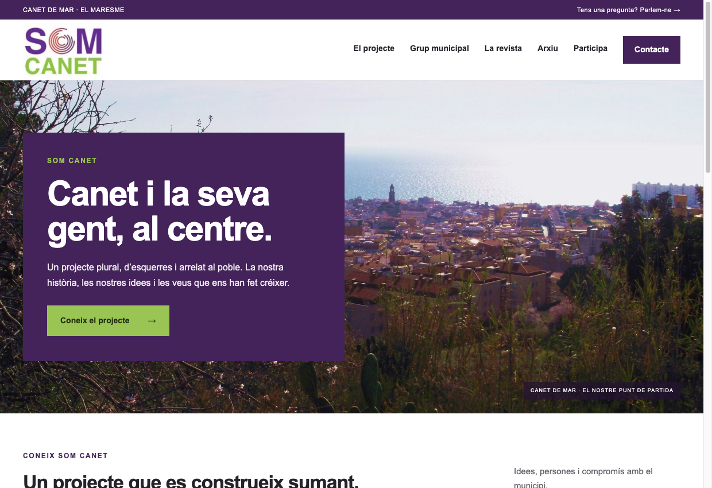
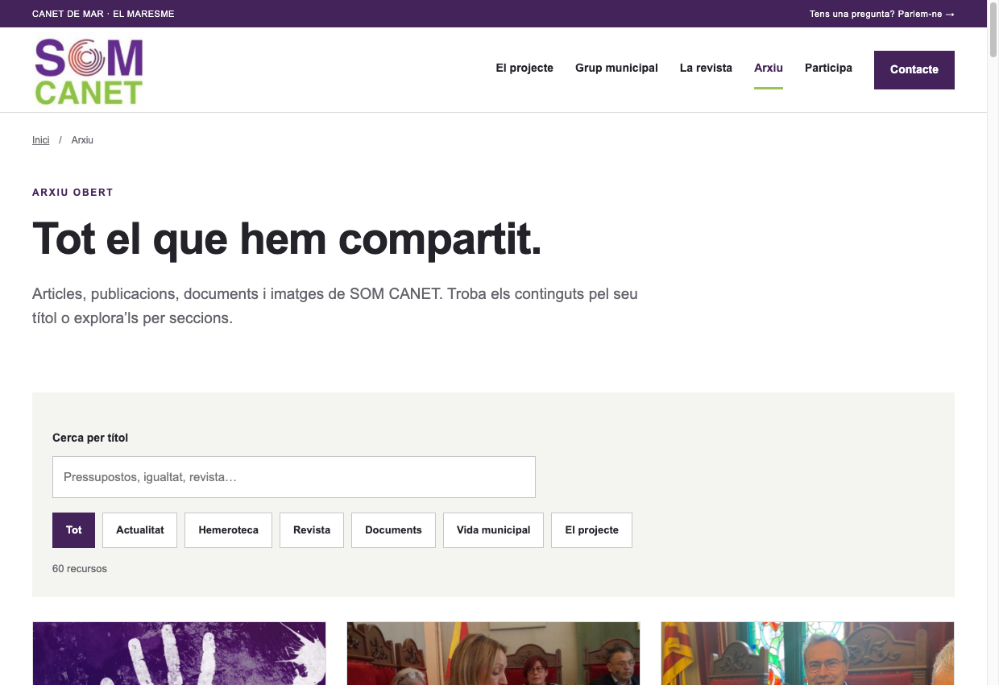
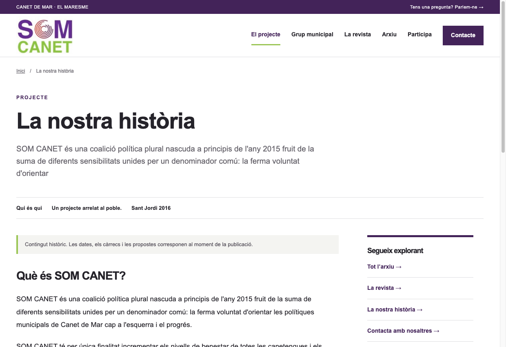

# Guia per editar el web de SOM CANET

Obre l’enllaç de **Sanity Studio** que t’ha passat l’equip i inicia sessió amb el compte convidat. A **Continguts**, el menú **Què vols editar?** et porta a les notícies, la portada i les pàgines del web.

Les captures són del web de SOM CANET. Et mostren on apareixeran els canvis.

| Vull… | On ho faig a Studio? | On es veu al web? |
| --- | --- | --- |
| Afegir una notícia | **Notícies de l’Arxiu → +** | A **Arxiu** i a la pàgina de la notícia. Les notícies actuals també poden sortir a la portada. |
| Canviar el text o la foto principal de la portada | **Portada i dades de contacte** | A la portada. |
| Editar una pàgina que ja existeix | **Pàgines principals →** tria la pàgina | A la mateixa pàgina del web. |
| Afegir una revista o un PDF | **Revistes i documents PDF → +** | A **Arxiu → Documents** i a la pàgina del PDF. |
| Afegir una persona o un vídeo | **Persones de l’equip** o **Vídeos de l’arxiu** | A **Qui és qui** o a **Vídeos**. |

## Crear una notícia

1. A **Notícies de l’Arxiu**, prem **+** i escriu el **Títol**.
2. A **Adreça de la pàgina**, prem **Genera**. La data ja es proposa amb la data actual. Revisa-la si estàs recuperant una notícia antiga.
3. Escriu el **Resum** que es veurà a la targeta i el **Text** que es llegirà dins la notícia. Per afegir una foto a la targeta, usa **Imatge principal** i omple la **Descripció accessible** amb una frase que expliqui què es veu.
4. A **Filtre de l’Arxiu**, tria **Actualitat** per a una notícia nova, **Hemeroteca** per a material d’arxiu o **Revista** per a un article de la revista.
5. A **Edició visual**, obre **Arxiu**, busca el títol i obre la targeta per revisar la pàgina de la notícia. Si només estàs fent una prova, deixa-la com a esborrany.

### Què entra a Arxiu?

- **Notícies i articles.** Hi apareixen automàticament. **Filtre de l’Arxiu** determina amb quin filtre es troben.
- **Revistes i PDF.** Apareixen a **Documents**. **Document històric** indica el context del document.
- **Pàgines.** Si actives **Contingut històric**, la pàgina també apareix a **Arxiu**. Fes-ho quan el contingut sigui d’una etapa anterior.
- **Persones i vídeos.** Tenen el seu espai a **Qui és qui** i **Vídeos**.

## Editar una pàgina o afegir-hi un bloc

1. A **Pàgines principals**, obre la pàgina que vols canviar. Per exemple, **La nostra història**. Per editar la portada, obre **Portada i dades de contacte**.
2. Canvia el camp que correspongui. A **Edició visual** també pots seleccionar els camps marcats sobre la pàgina i obrir-los al formulari.
3. Per afegir una secció, ves a **Blocs de contingut** i tria **Text**, **Imatge** o **Crida a l’acció**. Per crear un botó, escriu el text del botó i la seva destinació. Per exemple, `/participa/`.
4. Arrossega els blocs per canviar-ne l’ordre i revisa el resultat a **Edició visual**. En una notícia o pàgina de text, apareixen després del text principal. A la portada i a les pàgines amb seccions pròpies, apareixen al final.

## Revisar i publicar

Studio desa automàticament l’**esborrany**. Revisa el títol, la foto i els enllaços a **Edició visual**. Quan estigui llest, prem **Publica**. Això guarda la versió publicada a Sanity.

**Durant la demostració**, després de publicar a Studio, la persona amb accés a GitHub ha d’executar [Publish to GitHub Pages](https://github.com/aminch18/som-canet-web/actions/workflows/pages.yml) amb **Run workflow** a `main`. Quan l’execució acabi, obre o recarrega la pàgina. Si retires una notícia de prova, torna a executar el workflow.

Si no veus **Edició visual** a l’Studio allotjat, demana a la persona responsable del web quin és l’entorn de proves. Per a les tasques del dia a dia, consulta la [fitxa ràpida](FITXA_RAPIDA.md).
